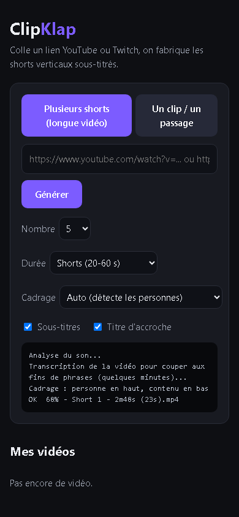

# ✂️ ClipKlap — Tes longues vidéos en shorts prêts à poster

**ClipKlap** transforme une vidéo YouTube ou Twitch en **shorts verticaux** pour TikTok, YouTube Shorts et Reels.
Tu colles un lien, tu cliques sur **Générer**, et tu récupères des shorts sous-titrés, bien cadrés et notés en % de chance de buzz.

Gratuit, sans compte, et tout se passe sur ton PC : tes vidéos ne partent nulle part.

🔗 **Présentation** : [https://clipklap.vercel.app](https://clipklap.vercel.app)

---

## ⬇️ Télécharger et installer (Windows 10 ou 11)

1. **[Télécharger ClipKlap.zip](https://github.com/BonkorAccessories/ClipKlap-app/releases/latest/download/ClipKlap.zip)**
2. Clic droit sur le fichier → **Extraire tout**.
3. Dans le dossier, double-clique sur **`Installer.bat`** (5 à 10 minutes la première fois).
   > Si Windows affiche « Windows a protégé votre ordinateur » : clique sur **Informations complémentaires** puis **Exécuter quand même**. C'est normal pour un petit programme gratuit qui n'est pas signé.
4. Un raccourci **ClipKlap** apparaît sur le Bureau : double-clique dessus, l'appli s'ouvre dans ton navigateur.

Le premier short prend un peu plus de temps : l'outil de sous-titres (environ 500 Mo) se télécharge une seule fois.

---

## 👀 Aperçu

<table>
  <tr>
    <td align="center"> <b>Sur ordinateur</b></td>
    <td align="center"> <b>Sur téléphone</b></td>
  </tr>
</table>

---

## 🚀 Comment ça marche

1. **Colle un lien** : vidéo YouTube, VOD ou clip Twitch.
2. **Choisis** : plusieurs shorts, ou un seul passage (ex. `1:23-1:50`), la durée (20-60 s pour les Shorts, 61-90 s pour TikTok) et le cadrage.
3. **Clique sur Générer** : tes shorts arrivent dans la galerie, du meilleur % au moins bon.
4. **Corrige si besoin** avec le bouton **Modifier**, puis télécharge et poste.

---

## ✨ Ce que fait ClipKlap

- 📈 **% de chance de buzz** pour chaque short (moments les plus revus sur YouTube + réactions fortes)
- ✂️ **Coupé aux fins de phrases** : chaque short commence et finit sur une phrase complète
- 🧍 **Cadrage automatique** :
  - deux personnes à l'écran → l'une au-dessus de l'autre
  - un streamer ou un journaliste + ses images → la personne en haut, le contenu en bas
  - sinon → la vidéo entière sur un fond flou
- 💬 **Sous-titres animés** : le mot prononcé s'allume en jaune
- 🪝 **Titre d'accroche** en haut du short
- ✏️ **Éditeur** : corrige l'accroche et les sous-titres, change le cadrage, et le short est refait en quelques secondes
- 📱 **Depuis ton téléphone** : sur la Wi-Fi de la maison, l'adresse à taper s'affiche sur la page du PC (protégée par une clé secrète)
- 📦 **Prêt à poster** : format vertical 1080 × 1920, moins de 10 Mo
- 🗓️ **Option avancée** : envoi programmé sur YouTube, un short par jour à 18 h (demande une clé Google Cloud)

---

## 🛠️ Technique

| Rôle | Outil |
|---|---|
| Téléchargement | yt-dlp |
| Montage | ffmpeg |
| Sous-titres | faster-whisper (sur le PC, gratuit) |
| Détection des visages | OpenCV + YuNet |
| Interface | Python 3.12 + HTML/CSS/JS |

---

## 📌 À venir

- Titres d'accroche écrits par une IA
- Découpe « par sujet » avec une IA
