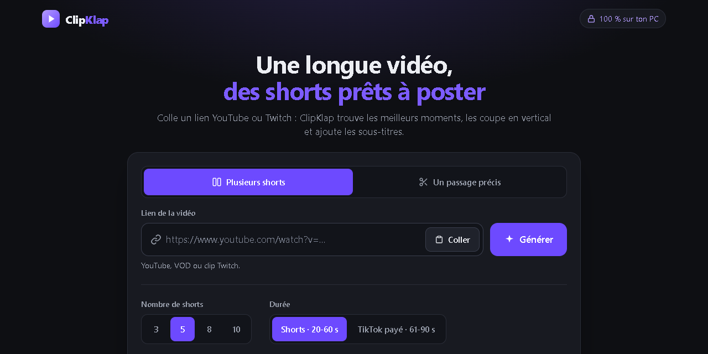

# ✂️ ClipKlap — Tes longues vidéos en shorts prêts à poster

**ClipKlap** transforme une vidéo YouTube ou Twitch en **shorts verticaux** pour TikTok, YouTube Shorts et Reels. Colle un lien, clique sur Générer : l'appli trouve les meilleurs moments, les coupe aux fins de phrases, ajoute des **sous-titres animés** et un **titre d'accroche**, et note chaque short avec son **% de chance de buzz**. Le cadrage se fait tout seul : deux présentateurs sont mis l'un au-dessus de l'autre, un streamer ou un journaliste passe en haut et son contenu en bas. Tout tourne sur ton ordinateur : gratuit, sans compte, et tes vidéos ne partent nulle part.

🔗 **Présentation** : [https://clipklap.vercel.app](https://clipklap.vercel.app)

---

## 👀 Aperçu de l'app

<table>
  <tr>
    <td align="center"> <b>Sur ordinateur</b></td>
    <td align="center"> <b>Sur écran étroit</b></td>
  </tr>
</table>

*Captures réalisées avec une galerie vide.*

---

## 🚀 Comment ça marche

1. **Colle un lien** : une vidéo YouTube, une VOD ou un clip Twitch.
2. **Choisis** : plusieurs shorts tirés d'une longue vidéo, ou un seul passage (ex. `1:23-1:50`) ; le nombre de shorts ; la durée (20-60 s pour les Shorts, 61-90 s pour TikTok) ; le cadrage ; les sous-titres et le titre d'accroche.
3. **Clique sur Générer** : une barre montre où en est la fabrication, puis tes shorts apparaissent dans la galerie, regroupés par vidéo et triés par % de buzz ou par date, à regarder, télécharger ou ouvrir dans leur dossier.

---

## ✨ Fonctionnalités principales

- 📈 **% de chance de buzz** pour chaque short : courbe YouTube des « moments les plus revus » (quand elle existe) + volume sonore (cris, réactions)
- ✂️ **Coupé aux fins de phrases** : toute la vidéo est transcrite, chaque short commence et finit sur une phrase complète
- 🧍 **Cadrage automatique** :
  - deux présentateurs à l'écran → l'un au-dessus de l'autre
  - une personne + du contenu (webcam sur un jeu, journaliste et ses images) → la personne en haut, le contenu en bas, avec un cadre qui suit le streamer s'il bouge
  - sinon → la vidéo entière au centre sur un fond flou
  - et un menu pour forcer le cadrage si besoin
- 💬 **Sous-titres animés** : trois mots à la fois, le mot prononcé s'allume en jaune
- 🪝 **Titre d'accroche** en haut, tiré de la phrase la plus forte du passage
- 🏷️ **Crédit du créateur** affiché en haut de chaque short
- 📦 **Prêt à poster** : 1080 × 1920, moins de 10 Mo
- 🔒 **100 % local** : la page s'ouvre dans ton navigateur mais tout se passe sur ton PC (adresse 127.0.0.1)

---

## 🛠️ Technique

| Rôle | Outil |
|---|---|
| Téléchargement | yt-dlp |
| Montage | ffmpeg |
| Transcription | faster-whisper (sur le PC, gratuit) |
| Détection des visages | OpenCV + YuNet |
| Interface | Python (bibliothèque standard) + HTML/CSS/JS |

Fonctionne sur **Windows** avec Python 3.12.

---

## 📌 À venir

- Éditeur : corriger le texte des sous-titres et l'accroche avant d'exporter
- Publication programmée aux meilleures heures
- Accroches écrites par une IA

---

*Projet personnel — code privé.*
